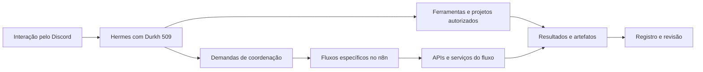
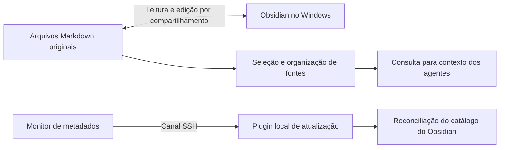
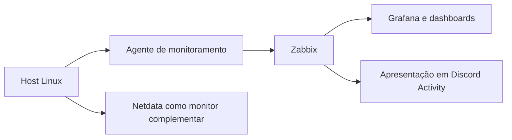

# Fluxos dos sistemas e integrações

[Voltar à apresentação](../README.md) · [Mapa dos sistemas](./Mapa-dos-Sistemas.md)

## Assistente e automação

O n8n participa dos fluxos para os quais foi integrado. Ele não é um intermediário obrigatório de toda ação do assistente. Scripts e ferramentas podem atender tarefas diretamente quando isso faz sentido.

Um exemplo público é [Factorio — Durkh Coop](https://github.com/DURKHEIM09/factorio-durkh-coop): o projeto começou com relatórios da fábrica e evoluiu para a interação do agente com o jogo. O repositório mantém o código e os detalhes dessa implementação.

A experiência com agentes especializados e workers temporários está em [Hermes/Durkh 509](https://github.com/DURKHEIM09/hermes-durkh-509). A documentação também registra partes ainda pendentes na integração geral de chamados, execução e progresso.

## Documentação e contexto

Há dois fluxos distintos na integração do Obsidian: o conteúdo das notas passa pelo compartilhamento de arquivos; o componente de atualização informa mudanças de metadados por SSH. O monitor não é um transporte do conteúdo das notas.

Os documentos originais continuam sendo a fonte. O grafo do Obsidian mostra vínculos documentais; ele não descobre sozinho as dependências dos serviços.

A estrutura pública e os modelos de organização ficam em [Neuro-Link e Obsidian](https://github.com/DURKHEIM09/neuro-link-obsidian). Este repositório não exporta o acervo pessoal nem o mecanismo privado de consulta.

## Observabilidade

Os registros relacionam Grafana ao backend Zabbix como fonte de métricas. Netdata tem papel complementar, mas não há evidência nessas fontes de que seus dados alimentem o Grafana.

O login incorporado no Discord exigiu tratamento específico de enquadramento, cookies e redirecionamento na stack de monitoramento. Essa é uma particularidade daquela implantação histórica; não se deve copiar ajustes de cabeçalhos para qualquer aplicação sem analisar sua política de sessão e de incorporação.
